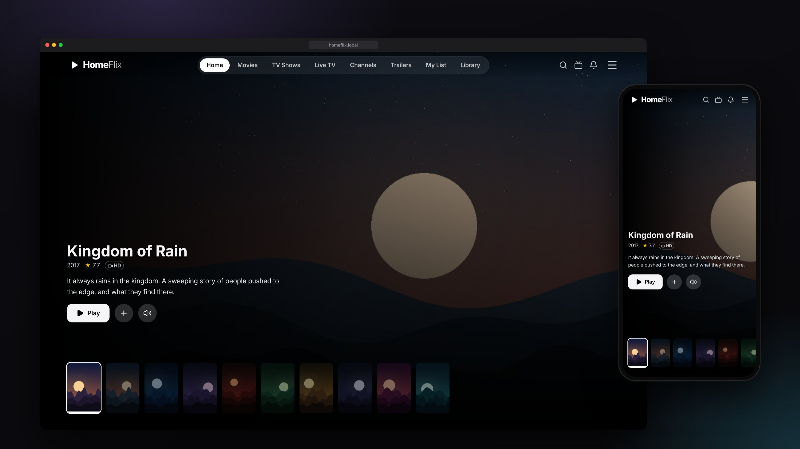
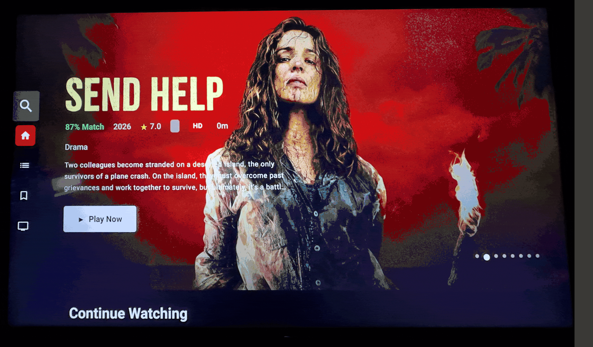
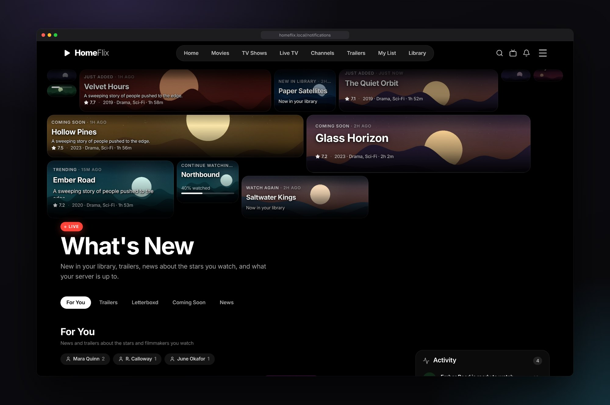
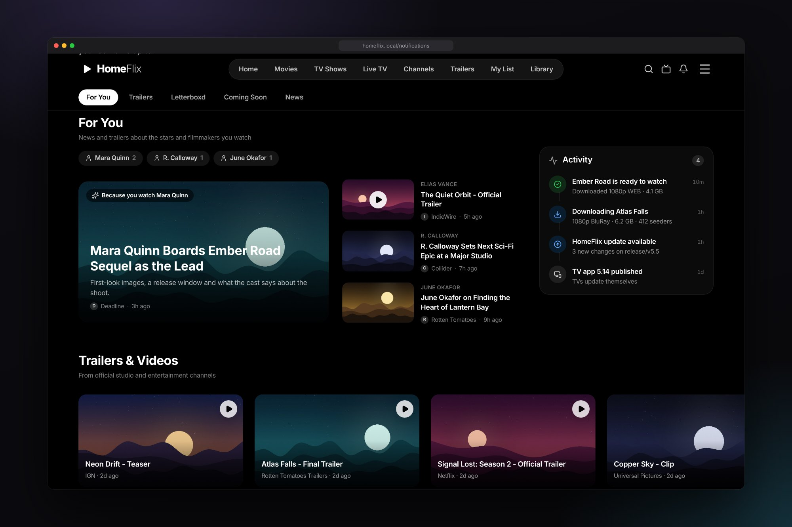
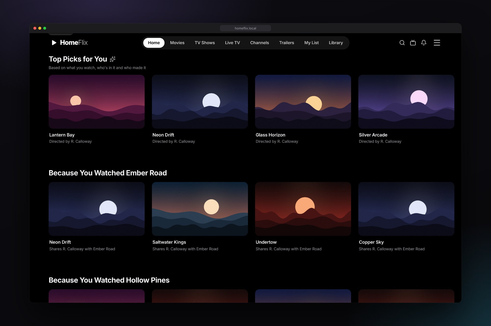
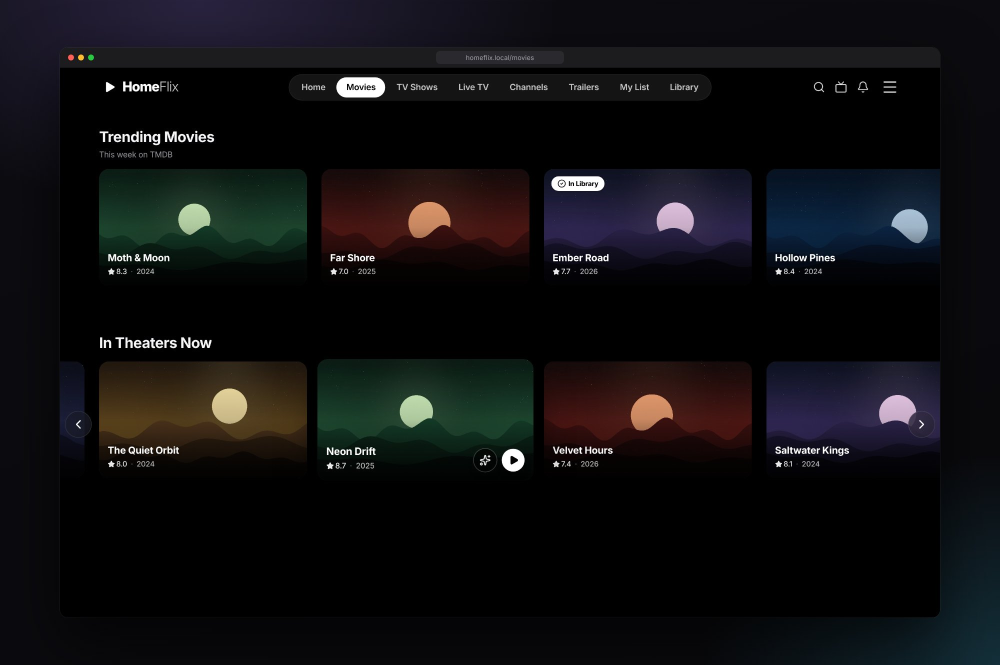
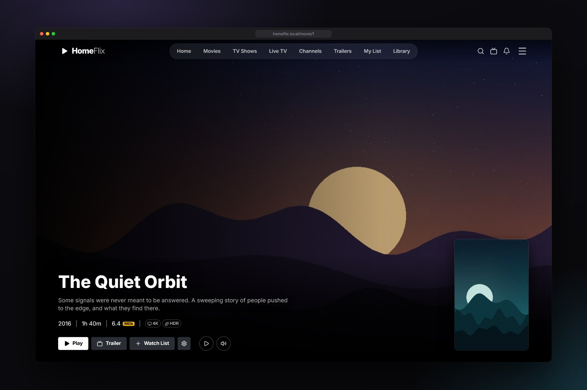
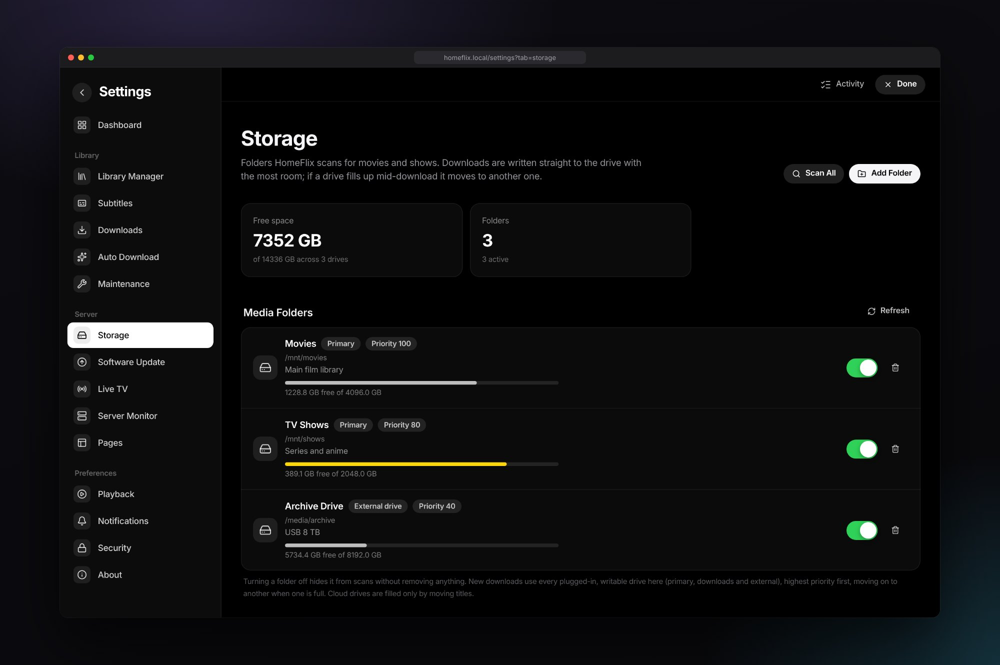
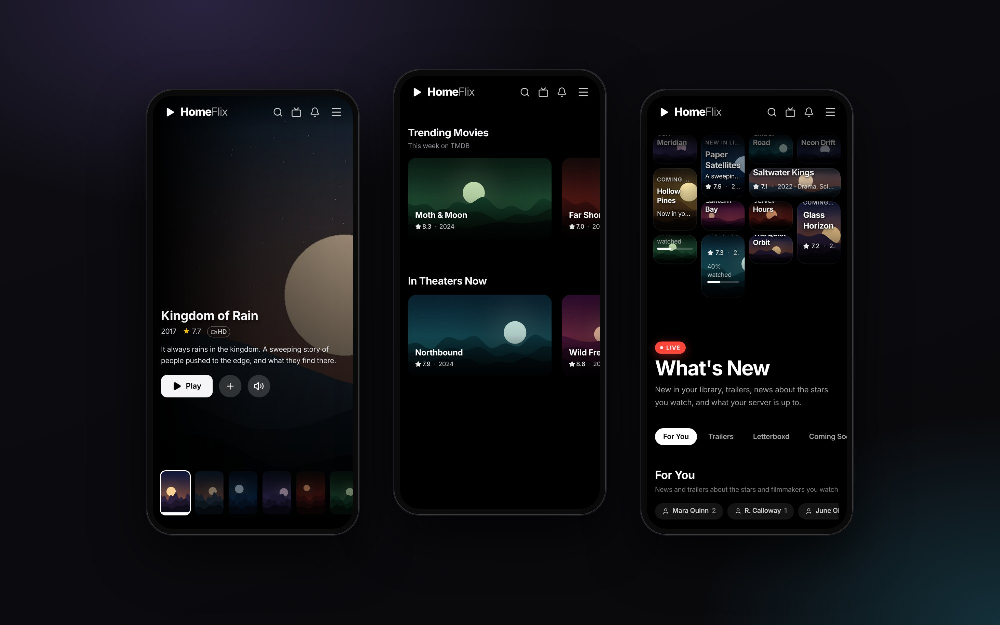

# HomeFlix

Your own streaming service for the movies and shows on your drives. HomeFlix
organises your library, streams it to any browser and Android TV on your
network, and can download, subtitle and preview titles for you.



▶️ [Demo on YouTube](https://www.youtube.com/watch?v=_IIKlyhlE_4) ·
📺 [HomeFlix TV app](https://github.com/azad25/homeflix-tv-app) ·
📝 [Release notes](RELEASE_NOTES.md)



## Features

- **Library**: scans your folders, matches titles with TMDB (posters,
  backdrops, cast, trailers) and groups shows by season.
- **Streaming**: direct play when the device can, otherwise on-the-fly HLS
  transcoding (GPU when available). Resume where you left off on any device.
- **Apple TV-style interface**: for web, phone and the Android TV app, with
  hover previews and trailers.
- **Cast**: send playback from the browser to the HomeFlix TV app.
- **Downloads**: one-click torrent downloads through Jackett. Downloads go to
  the drive with room, move if a drive fills up, and pause when every drive
  is full.
- **Coming Soon**: the 10 most anticipated upcoming movies and series,
  with trailers kept on the server and a Notify Me button that downloads
  them on release day.
- **Auto Download**: get titles from My List as soon as they're released, with
  a quality profile you choose.
- **Live TV**: free-to-air channels with health checks, a channel guide and
  full-screen TV mode.
- **Subtitles**: search and download from OpenSubtitles, auto-matched to your
  files.
- **For You**: recommendations and Top 10 charts learned from what you watch,
  plus personalised entertainment news and videos.
- **Storage**: several drives, cloud drives through rclone, and a size budget
  for preview clips.
- **Self-updating**: update the server and publish TV app builds from
  Settings.

## Screenshots

| | |
|---|---|
|  |  |
|  |  |
|  |  |



<sub>Mockups use made-up titles and artwork.</sub>

## Install

**Requirements:** Linux (or macOS), Go 1.21+, Node.js 18+ and FFmpeg.
Optional: Redis (faster asset loading), Docker (for Jackett), rclone (for
cloud drives).

```bash
# Ubuntu / Debian
sudo apt install golang-go nodejs npm ffmpeg redis-server

git clone https://github.com/azad25/homeflix-wifi.git
cd homeflix-wifi
./quick-start.sh        # or ./install.sh for the setup wizard
./start.sh
```

Then open **http://localhost:3008**, or `http://<server-ip>:3008` from other
devices. The API runs on port 8252. Add your media folders in
**Settings → Storage**.

More detail is in [INSTALLATION.md](INSTALLATION.md).

### Run as a service (systemd)

```bash
sudo cp homeflix.service /etc/systemd/system/   # edit User and paths first
sudo systemctl daemon-reload
sudo systemctl enable --now homeflix
journalctl -u homeflix -f                       # logs
```

The service runs `scripts/start-service.sh` and `scripts/stop-service.sh`
from the repository folder.

## Configuration

Put these in `backend/.env` or in the service's environment:

| Variable | Purpose |
|---|---|
| `TMDB_API_KEY` | Movie and show metadata (required) |
| `MEDIA_PATH` | Default media folder (more can be added in Settings) |
| `OPENSUB_API_KEY`, `OPENSUB_USERNAME`, `OPENSUB_PASSWORD` | Subtitle downloads |
| `REDIS_URL` | Redis cache, e.g. `redis://localhost:6379` |
| `YOUTUBE_API_KEY` | Music and video features (optional) |
| `HW_ACCEL` | Force a hardware encoder (detected automatically otherwise) |

**Torrent downloads:** run `./setup-jackett.sh`, then enter the Jackett URL
(`http://localhost:9117`) and API key in **Settings → Downloads**.

## Updating

Go to **Settings → Software Update**. HomeFlix pulls the newest commit of your
release branch, offers newer release branches, rebuilds, and rolls back if the
build fails.

## Docs

- [Live TV and the TV app API](docs/LIVE_TV.md)
- [Coming Soon trailers and Notify Me](docs/COMING_SOON.md)
- [Casting protocol](docs/TV_CAST_PROTOCOL.md)
- [TV app updates](docs/TV_APP_UPDATES.md)
- [Recommendations](docs/PERSONALISATION.md)
- [Torrent setup](documentation/COMPLETE_TORRENT_SETUP_GUIDE.md)

## Troubleshooting

- Ports 3008 (web) and 8252 (API) must be free.
- Check `startup.log` or `journalctl -u homeflix`.
- The user running HomeFlix needs read access to your media folders and write
  access to its download folders.

---

If you enjoy HomeFlix, please ⭐ the repository.
